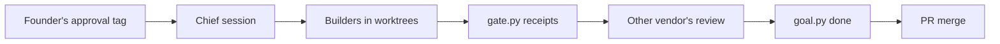

# SWE Agent

## Overview

SWE Agent runs coding-agent work in Claude Code and Codex as approved goals that a script declares done.
Agent work tends to drift: long review loops, done decided by a model's judgement, and private facts
leaking into commits. Here a goal is planned in a few bounded documents, approved once by the
founder, built task by task in isolated worktrees, checked by a mechanical gate and merged by
milestone. A guard keeps home paths, private names, emails and secrets out of every commit. There
is no runtime, hosted service or CI.

## Current state

In use. `install/` ships one skill, `execution-methodology`, with its scripts, references and agent
files; a global instruction file for both harnesses; the guard and its hook installer; and the
installer and repository gate. Work in flight is under [docs/goals/](docs/goals/); why things are
as they are is in [decisions.md](docs/decisions/decisions.md).

## Product requirements

| Page | What it holds |
|---|---|
| [prd.md](docs/product/prd.md) | Users, jobs, principles, surface and non-goals |
| [measurements.md](docs/product/measurements.md) | The numbers behind the methodology's choices |

## Architecture



Once the founder tags a goal approved, the chief session hands each task to a builder in its own
worktree, records gate receipts, has the other vendor review the milestone diff, and opens the PR
once `goal.py done` passes. Design, reasons and accepted risks are in
[methodology.md](docs/architecture/methodology.md).

## Components

| Component | Responsibility | Entry point | Page |
|---|---|---|---|
| `install.sh` | Installs, updates or uninstalls the skill, global file and agent files in both homes, naming any installed file edited in place | `install/install.sh` | [install/README.md](install/README.md) |
| `verify.sh` | The repository gate; its last line is the verdict | `install/verify.sh` | [install/README.md](install/README.md#the-gate) |
| `global.md` | The global instruction file both harnesses load | `install/global.md` | [methodology.md](docs/architecture/methodology.md) |
| The skill | The rules for running a goal, with references loaded on demand | `install/skills/execution-methodology/SKILL.md`, `references/` | [methodology.md](docs/architecture/methodology.md#shape) |
| `goal.py` | Plan lint, status, next, resume, review, packet, cost, own, cleanup and the done check | `scripts/goal.py` | [methodology.md](docs/architecture/methodology.md#shape) |
| `gate.py` | Runs a gate and records its receipt against the tree | `scripts/gate.py` | [methodology.md](docs/architecture/methodology.md#shape) |
| `modmap.py` | Loads the test-module map and picks the modules a task's writes reach | `scripts/modmap.py` | [modules.md](install/skills/execution-methodology/references/modules.md) |
| `docs.py` | Page lint, index, pointers, `reads:` ranges, links and the stale warning | `scripts/docs.py` | [repository.md](install/skills/execution-methodology/references/repository.md) |
| `guard.py` with `git-hooks.sh` | Blocks private facts, secrets and direct default-branch pushes at commit and push | `scripts/guard.py`, `scripts/git-hooks.sh` | [github.md](docs/runbooks/github.md) |
| The agent files | The builder, reviewer and scout roles for each harness | `agents/` | [roles.md](install/skills/execution-methodology/references/roles.md) |

Paths under `scripts/` and `agents/` are inside `install/skills/execution-methodology/`.

## Run locally

From a fresh clone, with Python 3.10+ and git:

```bash
cd install
./install.sh --dry-run     # print every action, write nothing
./install.sh               # install or update both homes
./verify.sh                # the repository gate; its last line is the verdict
```

Then, in each product clone, install the guard hooks:

```bash
~/.claude/skills/execution-methodology/scripts/git-hooks.sh [REPO]
```

More options, rollback and what installs where: [install/README.md](install/README.md).

## Working in this repository

Agents start at [AGENTS.md](AGENTS.md). The gate is `cd install && ./install.sh --dry-run &&
./verify.sh`, and its last line, `verify: PASS`, is the verdict.

Work lands as goals under [docs/goals/](docs/goals/), each milestone merged by PR. Once the merge
review passes and `goal.py done` prints DONE, the chief pushes the branch and opens the PR; once the
founder says to merge, the chief merges it.

[MIT license](LICENSE)

<!-- covers: [install/install.sh, install/verify.sh, install/global.md, install/skills/execution-methodology/SKILL.md, install/skills/execution-methodology/scripts/**, install/skills/execution-methodology/agents/**] -->
